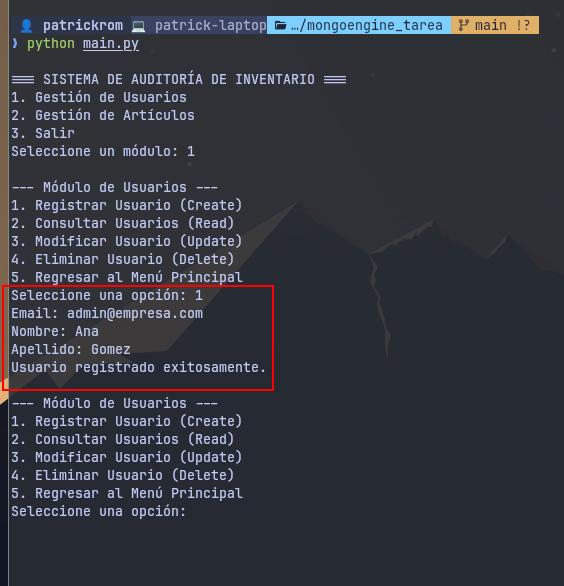
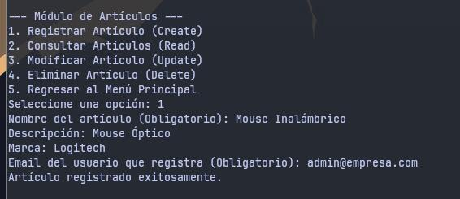
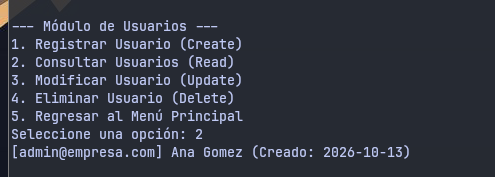
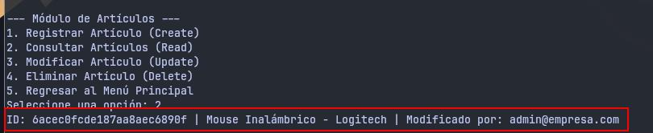
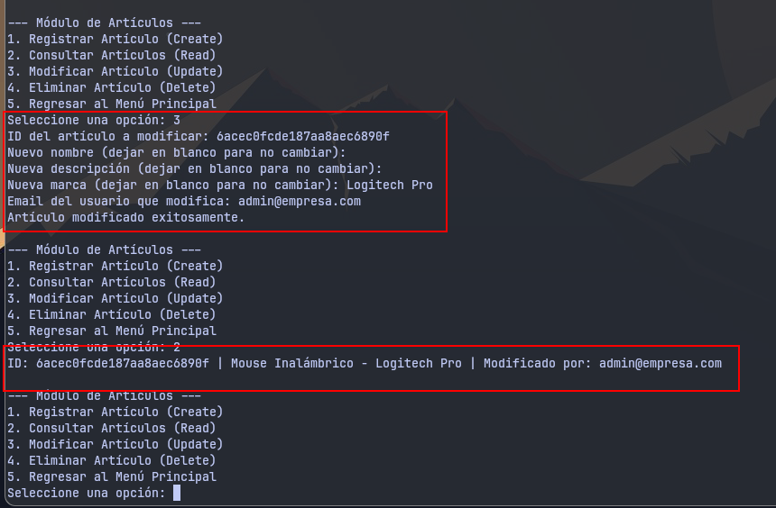
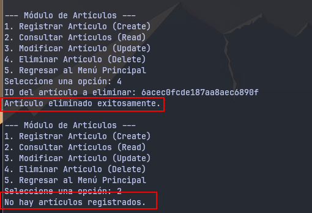
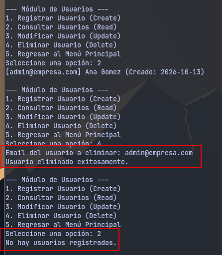
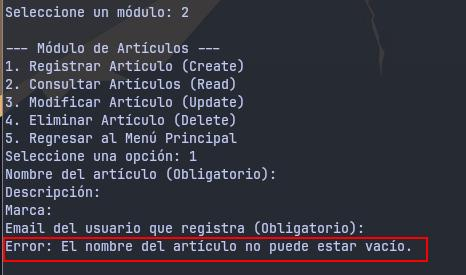
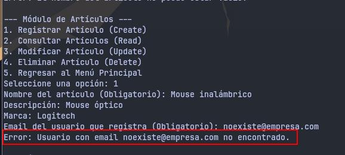

# Informe Técnico: Sistema de Auditoría de Inventario

## 1. Organización del Código
El sistema aplica el principio de responsabilidad única mediante un patrón de diseño en tres capas. El código está dividido en tres módulos principales:
* **`modelos.py` (Capa de Datos):** Define las clases `Usuario` y `Articulo`, estableciendo el esquema estricto y las relaciones estructurales en la base de datos mediante MongoEngine.
* **`controlador.py` (Capa de Lógica):** Contiene todas las funciones CRUD y ejecuta las reglas de negocio (validaciones de nombres vacíos, correos duplicados e integridad referencial). Actúa como puente entre la interfaz y la base de datos.
* **`main.py` (Capa de Presentación):** Gestiona exclusivamente la interfaz por consola, los menús interactivos y la captura de errores (`try-except`) para garantizar que la aplicación no se cierre inesperadamente.

## 2. Justificación del Almacenamiento
**Tecnología elegida:** MongoDB gestionado a través del ODM MongoEngine.
* **Ventajas:** Permite trabajar con documentos como si fueran objetos nativos de Python, facilitando la creación de esquemas estructurados sin sacrificar la flexibilidad de NoSQL. Maneja automáticamente referencias cruzadas (`ReferenceField`) garantizando la integridad de quién modificó el artículo.
* **Desventajas:** Requiere tener el servicio de MongoDB en ejecución en el servidor (a diferencia de un archivo plano o SQLite que es *serverless*).

## 3. Estrategia de Claves
* **Usuarios:** Se utiliza el campo `email` como clave primaria natural. MongoEngine aplica la restricción `unique=True`, garantizando que no existan duplicados a nivel de base de datos.
* **Artículos:** Se utiliza el `ObjectId` (`_id`) autogenerado por MongoDB, ya que los artículos pueden compartir nombres idénticos. La relación se vincula inyectando el objeto `Usuario` directamente en el `ReferenceField`.

---

## 4. Guía de Pruebas y Evidencia de Ejecución

### A. Operaciones CRUD (Casos de Éxito)

**1. Create (Creación)**
*Registro de un nuevo usuario en el sistema.*

*Registro de un nuevo artículo asociado al usuario creado.*

**2. Read (Consulta)**
*Listado de usuarios registrados.*

*Listado de artículos mostrando el ID y el usuario responsable.*

**3. Update (Modificación)**
*Actualización de datos de un artículo existente usando su ID.*

**4. Delete (Eliminación)**
*Eliminación exitosa de un artículo.*

*Eliminación exitosa de un usuario.*

---

### B. Validaciones y Reglas de Negocio (Fallos Controlados)

**Fallo 1: Validación de campos vacíos**
*El sistema impide crear un artículo sin especificar un nombre.*

**Fallo 2: Integridad Referencial**
*El sistema rechaza la creación de un artículo si se intenta asociar a un usuario que no existe.*

